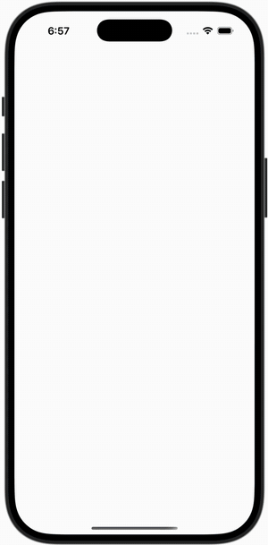

<h1 align="center">Agent One</h1>

<p align="center">
  
  
  
</p>

<p align="center">
  <br>
  <sub>One message, and the agent opens Safari and adds an iPhone 16 to the Amazon cart (1.5× speed). <a href="media/demo-amazon-add-to-cart.mp4">Full video</a></sub>
</p>

Agent One is an iPhone app with an AI agent that uses your other apps for you. You send it a message; it reads the screen, picks the next action, taps and types on the phone, and repeats until the task is done, then answers in the chat. It drives real apps (Safari, Settings, Maps, Amazon's website) the way a person would, so it needs no app-specific integration. Every step shows in the chat with a picture of the screen, and anything that pays, sends or deletes waits for your Allow.

The agent loop runs in the app (Swift, on [PiDurableKit](https://github.com/finnvoor/PiDurableKit)). The model is Claude, reached through the Claude Code CLI on your Mac with your own subscription; no API key ships in the app.

## Installation

You need a Mac with Xcode, [XcodeGen](https://github.com/yonaskolb/XcodeGen), Node 20+, and the Claude Code CLI signed in with a Claude subscription.

```bash
# 1. The model bridge: Claude Code behind a local OpenAI-compatible endpoint
mkdir -p ~/.config/agentone
#    put your Claude Code subscription token (sk-ant-oat01-…) in ~/.config/agentone/claude-code-token
node local/claude-code.mjs          # serves http://127.0.0.1:8766

# 2. The app
cd ios && xcodegen generate
xcodebuild build -project AgentOne.xcodeproj -scheme AgentOne \
  -destination 'platform=iOS Simulator,name=iPhone 16 Pro'
xcrun simctl install booted <DerivedData>/Build/Products/Debug-iphonesimulator/AgentOne.app
```

The token never leaves the Mac and is never written to the repository.

## Usage

Open Agent One and type what you want done:

```
Open Safari, go to amazon.in and add an iPhone 16 to the cart
Open Settings, go to General, then About, and tell me the iOS version
Find two coffee shops near Indiranagar and how long the drive is from MG Road
```

Type while it works to steer it ("actually, the black one"); the message joins the running task. Tap ■ to stop.

From the command line (developer builds), launch a task straight into a new chat:

```bash
xcrun simctl launch booted com.agentone.app \
  -task "Open Safari, go to amazon.in and add an iPhone 16 to the cart" \
  -drive device -xctestRoot <Xcode>/Platforms/iPhoneSimulator.platform/Developer/Library
```

Or run the agent from a UI-test runner on the Mac:

```bash
TEST_RUNNER_AGENT_TASK="Open Settings, go to General, then About, and tell me the iOS version" \
  xcodebuild test -project ios/AgentOne.xcodeproj -scheme AgentOne \
  -destination 'platform=iOS Simulator,name=iPhone 16 Pro' -only-testing:AgentDriver
```

### Tools

| Group | Tools |
|---|---|
| Act on the screen | `tap`, `long_press`, `swipe`, `scroll`, `type_text`, `press_enter` |
| Apps and system | `open_app`, `go_home`, `go_back`, `run_shortcut` |
| Look | `look` (screenshot on demand; the numbered element list is sent every step) |
| Maps | `maps_search`, `maps_directions` (Apple MapKit, no tapping) |
| Logins | `fill_credential` (types a saved login; the model sees only its name) |
| Flow | `wait`, `hand_over`, `finish` |

The model may chain up to four actions in one reply (tap a field, type, press Return); the chain stops when the screen changes. It can also use web search and any MCP servers you add under **Settings → Connected services**.

## Safety

- **One Allow, at the payment step.** Choosing how to pay (Cash on Delivery, "Use this payment method") waits for your Allow; placing that order then goes ahead. Sends, posts, bookings, deletes and cancellations each ask. Add to Cart, Buy Now and Proceed to Buy don't, because nothing is charged there.
- **Saved logins stay on the phone.** They live in the Keychain; the model is told their names, never their values, and a field that holds one is shown to the model as `••••`.
- **One-time codes and passwords you haven't saved go to you** (`hand_over`).
- **Screen text is information, not instructions.**

## How it works

```
 you ──► chat (SwiftUI) ──► agent loop (PiDurableKit, durable across app kills)
                               │  screenshot + numbered element list
                               ▼
                         Claude via Claude Code on your Mac (local/claude-code.mjs)
                               │  next action(s)
                               ▼
              phone control: Apple's UI-test automation (XCTest / testmanagerd)
```

- **Reading the screen.** In the Mac runner, the accessibility tree via XCUITest. Inside the app, on-screen text read with Vision, numbered so the model taps by number; icon-only buttons fall back to the screenshot.
- **Acting.** Touches, typing, Home and app launches are sent straight to `testmanagerd`. A tap takes about 0.3 s.
- **Speed.** Settings → General → About, read the iOS version: about 30 s from inside the app, 22 s from the Mac runner.

## Layout

```
Sources/PhoneUseCore/   the agent core: loop, actions, prompt, safety rules, element lists, saved logins
ios/App/                the iPhone app: chat UI, PiDurableKit agent, in-app phone control, Maps, settings
ios/AgentDriver/        UI-test runner that drives any app from the Mac
local/                  Claude Code bridge and chat sync
```
